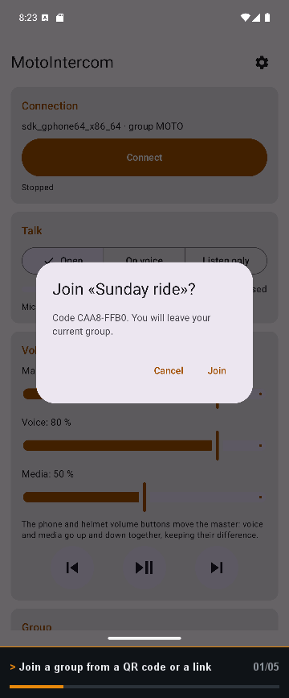
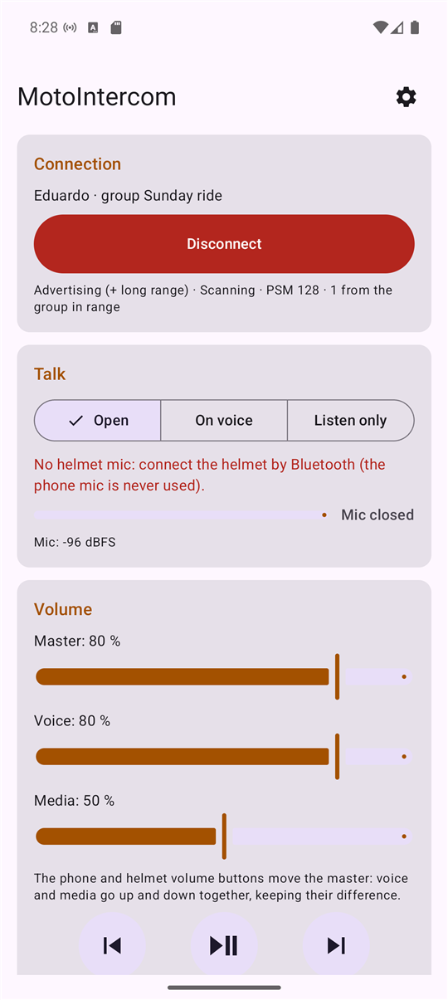
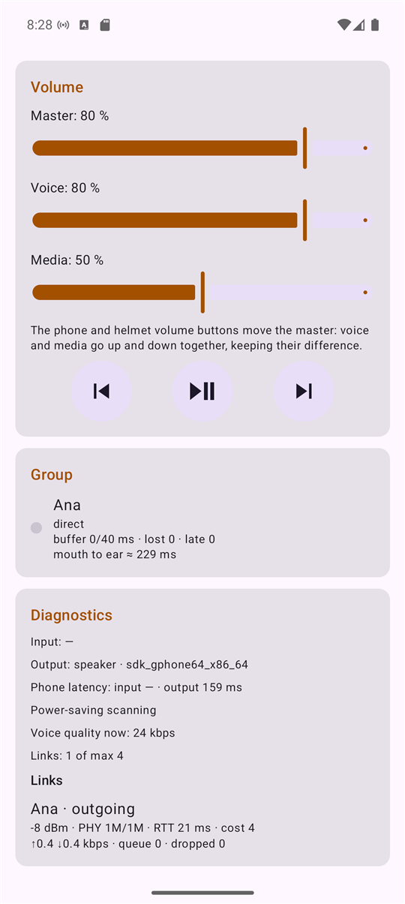
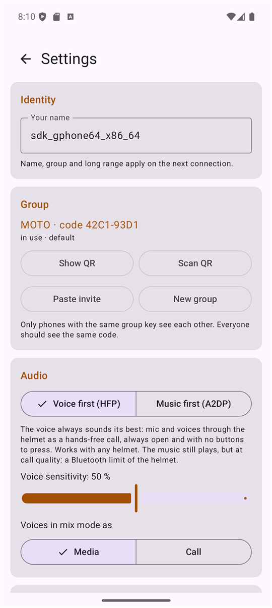
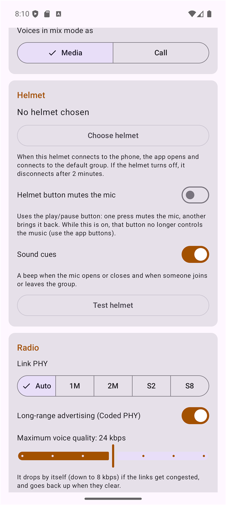

<!--
  TODO before going public:
  - Publish a first release so the "download" badge and the APK link work.
  - Check the Play Store link (the application id is com.sanabria.motointercom) once the app is published.
-->

<div align="center">

# MotoIntercom

### A motorbike intercom made of your phones. No signal, no servers, any helmet.

Talk to your riding partner or your whole group over **Bluetooth Low Energy**, with your own helmet and your own music.<br>
Each rider keeps the helmet paired to their phone as usual, and the phones talk to each other: a relay mesh, encrypted end to end, that rebuilds itself whenever someone drops out and comes back.

[](#requirements)
[](#how-it-works)
[](LICENSE)
[](https://ko-fi.com/Eduzyrtin)
[](#privacy)
[](#features)
[](https://github.com/Eduzyrtin/MotoIntercom/releases/latest)



**[Get it on Google Play](https://play.google.com/store/apps/details?id=com.sanabria.motointercom)** · **[Download the APK](https://github.com/Eduzyrtin/MotoIntercom/releases/latest)** · [Getting started](#getting-started) · [How it works](#how-it-works) · [Helmets and audio modes](#helmets-and-audio-modes) · [FAQ](#faq)

> **Free, on Google Play and GitHub.** MotoIntercom is completely free. Install it from **[Google Play](https://play.google.com/store/apps/details?id=com.sanabria.motointercom)** for automatic updates, or download the APK from **[GitHub Releases](https://github.com/Eduzyrtin/MotoIntercom/releases/latest)**. Same app either way.

</div>

---

## Why this exists

Motorbike intercoms (Sena, Cardo…) are expensive, only talk to their own brand and, outside their own mesh, don't reach beyond a few hundred metres. Group chat apps need mobile coverage, and on a mountain road you often have none.

MotoIntercom takes a different route. **Your phone is the intercom.** It talks to the other phones in your group directly over Bluetooth, so it works with **any helmet that you can already pair to your phone**, mixes brands freely (a Sena with a Cardo and a plain Bluetooth headset) and needs **no cell coverage, no account and no server**.

It is a light "Discord over Bluetooth" with automatic reconnection. It does not try to beat the kilometres of a dedicated mesh radio: the realistic range of one link is **30 to 100 m**, and the relay mesh chains hops for groups that stretch out in a line.

And it has **no internet access at all**. It doesn't even request Android's internet permission, so the system won't let it connect to anything: your voice never leaves the group.

<table>
  <tr>
    <td align="center"><br><sub>Connect, talk, volume and music</sub></td>
    <td align="center"><br><sub>A linked group with latency and links</sub></td>
    <td align="center"><br><sub>Groups with QR and audio modes</sub></td>
    <td align="center"><br><sub>Helmet test and radio</sub></td>
  </tr>
</table>

## Features

### 🏍️ Made for riding
- **Group of any size** with a name and a random key. Share it by **QR code**, by a `motointercom://join` **link** or by pasting the text. Two groups with the same name never mix.
- **Relay mesh**: if the first rider is out of range of the last one, the riders in between pass the voice along (up to 8 hops). If everybody can see everybody, nobody relays.
- **Always open or voice activated**, or listen only. No push-to-talk: with gloves on and your hands on the handlebar you can't press anything.
- **Auto-connect when your helmet turns on**: choose your helmet once and the app opens and joins your default group by itself. It hangs up two minutes after the helmet goes away.
- **Saved groups**, with a default one (your partner, say) and another one for group rides.
- **Sound cues** for the mic opening or closing and for someone joining or leaving, because on a bike you don't look at the screen.
- Keeps running with the **screen off and the app closed**, through a foreground service whose notification lets you mute or disconnect.

### 🎧 Your helmet, your music
- **Voice first (HFP)**: mic and voices through the helmet as a hands-free call, always open. Works with any helmet.
- **Music first (A2DP)**: your music never loses quality and voices arrive mixed with it. The helmet mic only works with **LE Audio**; with a classic Bluetooth helmet you listen.
- **Helmet test**: records 3 seconds through your helmet mic, plays them back, measures the audio route and **recommends a mode**. It also keeps a list of tested helmets that you can share.
- **Three volumes**: master, voice and media. The master moves both while keeping their difference, and the volume buttons of the phone or the helmet move the master.
- **Music controls** (previous, play/pause, next) in the main screen, and an optional helmet button that mutes the mic.
- The phone's own microphone is **never** used, only the helmet's.

### 📡 Solid radio
- **BLE L2CAP** links, with **Coded PHY** long-range advertising and 2M PHY when the phone supports them.
- **Adaptive voice quality**: Opus at 8 to 48 kbps (24 by default). It steps down by itself if the links get congested and back up when they clear.
- **Link costs** from signal strength, dropped voice and round-trip time, so routes avoid a bad direct link when two good hops exist.
- **Dead links** are detected in 6 seconds and reconnected without waiting for the Bluetooth timeout. If you turn Bluetooth off and on, the mesh comes back by itself.
- **Adaptive scanning** that is fast while someone is missing and saves power once the mesh is stable.
- A **diagnostics** screen with the audio route, every link's signal, PHY, RTT, throughput and drops, measured phone latency and an estimated mouth-to-ear delay per rider.

### 🔒 Private by design
- **AES-256-GCM on every link**, with a key derived from the group key and two nonces. Without the key you can neither listen nor inject anything, and a copied handshake goes nowhere.
- Names travel encrypted inside the mesh, not in the advertisement.

### 🟢 A UI that gets out of the way
- Jetpack Compose interface with the connection, talk, volume and group controls on one screen and the rest under **Settings**.
- Available in **English, Spanish, French, German, Italian, Portuguese, Catalan, Basque and Galician**, and you can pick the language per app on Android 13+.

## How it works

1. **Advertise and scan.** Every phone advertises a small BLE beacon that carries a short group id and the port of its L2CAP socket. Only phones that share your group key recognise each other.
2. **Connect and authenticate.** Two phones open an L2CAP channel and prove to each other that they know the group key. From the first byte after the handshake everything is encrypted.
3. **Voice in 20 ms frames.** The mic is encoded with **Opus** (48 kHz mono, forward error correction) and sent along the shortest path of the mesh. Each listener has a jitter buffer that grows and shrinks with the conditions.
4. **Mix and play.** All the voices and the cues are mixed with a soft limiter and played through your helmet.

The full design, the protocol and the roadmap are in [`docs/PROYECTO.md`](docs/PROYECTO.md) (in Spanish).

## Getting started

### Requirements
- Android **10** (API 29) or newer, with Bluetooth LE. Coded PHY and extended advertising are used when the phone has them.
- A Bluetooth **helmet or headset paired to your phone**, as usual.
- Every rider needs the app.

### 1 · Install
Get it from **[Google Play](https://play.google.com/store/apps/details?id=com.sanabria.motointercom)**, or download the latest `MotoIntercom-*.apk` from **[Releases](https://github.com/Eduzyrtin/MotoIntercom/releases/latest)** and open it. For the APK, Android will ask you to allow installs from your browser or file manager; allow it. Only install an APK from this repository's Releases page.

### 2 · Allow the permissions
The app asks for **Bluetooth**, **microphone** and **notifications**. It needs them to find the other phones, to listen to you and to show the notification that keeps it alive with the screen off.

### 3 · Create a group and invite your people
In the main screen choose **New group**, then **Show QR**. The others tap **Scan QR** (or open the link you share with **Share**). Everybody should see the same short code.

### 4 · Test your helmet
Open **Settings → Helmet → Test helmet** and run the test. The app records through your helmet mic and tells you whether **Voice first** or **Music first** suits it.

### 5 · Ride
Tap **Connect**. Put the phone in your pocket or on its mount. If you chose your helmet in Settings, you can skip this step from now on: turning the helmet on is enough.

## Helmets and audio modes

A classic Bluetooth helmet can't give you a good microphone and good music at the same time. It is a limit of Bluetooth itself: A2DP (music) and HFP (calls) can't be active together. So MotoIntercom lets you choose:

|  | **Voice first (HFP)**, default | **Music first (A2DP)** |
|---|---|---|
| Microphone | Always, on any helmet | Only with **LE Audio** helmets |
| Voices | Through the helmet as a hands-free call | Mixed with the music, as media |
| Music quality | **Call quality** (a Bluetooth limit) | Intact |
| Best for | Talking all the time with a classic helmet | Helmets with LE Audio, or listening only |

With **LE Audio** (LC3) the helmet has mic and good music at once, and the app tells you when it detects it.

## Privacy

- MotoIntercom **does not have the Internet permission**. Android itself prevents it from sending anything anywhere. No analytics, no ads, no accounts.
- **Nothing is recorded.** Voice goes from your microphone, encrypted, straight to the phones in your group, and it is played and discarded.
- The **microphone** is used only while you are connected. The **Bluetooth** permissions find and connect to the other phones. **Notifications** keep the connection alive and let you mute from the shade.
- The helmet you choose is linked as a companion device only so that Android lets the app open itself when the helmet turns on.

## FAQ

<details>
<summary><b>Does it work with my helmet?</b></summary>

If you can pair it to your phone as a Bluetooth headset, yes. What changes is the mode: with a classic helmet use **Voice first**; with LE Audio you can use **Music first** and keep your music intact. The helmet test in Settings recommends one for you.
</details>

<details>
<summary><b>Can it talk to a Sena or Cardo intercom?</b></summary>

Not directly: those use their own radios. But you can mix brands inside a MotoIntercom group, because each rider only connects their helmet to their own phone.
</details>

<details>
<summary><b>What is the range?</b></summary>

Realistically **30 to 100 m** between two phones (in a pocket or on a mount). The mesh chains links for riders who are in a line. It is not meant to compete with the kilometres of a dedicated mesh radio.
</details>

<details>
<summary><b>Does it need mobile coverage or a server?</b></summary>

No. It is pure Bluetooth between phones, and the app has no internet permission.
</details>

<details>
<summary><b>Why does my music sound worse in Voice first?</b></summary>

Because a classic Bluetooth helmet can only have a microphone in call mode (HFP), and then **everything**, music included, goes at call quality. It's the same thing Discord or any call does. Choose **Music first** if you prefer to keep the music intact and only listen, or use a helmet with LE Audio.
</details>

<details>
<summary><b>Is there an iPhone version?</b></summary>

Not yet. It is planned: the protocol and the core are written to be reused, but it needs a Mac and a way to test it on a real iPhone.
</details>

<details>
<summary><b>Will it drain my battery?</b></summary>

It keeps a Bluetooth link, the mic and the audio running, so it uses power, like a call would. The app uses lighter scanning once the mesh is stable, and Settings → Battery shows whether Android could stop it with the screen off.
</details>

<details>
<summary><b>Will you add &lt;feature&gt;?</b></summary>

Ideas are welcome: [open an issue](https://github.com/Eduzyrtin/MotoIntercom/issues) so they don't get lost. The roadmap is at the end of [`docs/PROYECTO.md`](docs/PROYECTO.md).
</details>

## Found a bug? Have an idea?

Please open an **[issue](https://github.com/Eduzyrtin/MotoIntercom/issues)** with your phone and helmet models, the Android version, the audio mode and what happened. A screenshot of the **diagnostics** screen helps a lot, and so does sharing your helmet test results (**Settings → Tested helmets → Share results**), which are used to grow the app's list of helmets.

## Building from source

```bash
git clone https://github.com/Eduzyrtin/MotoIntercom.git
```

Open the folder in **Android Studio** (it installs the NDK and CMake that it asks for) and run the `debug` variant, or from a terminal:

```bash
./gradlew assembleDebug
./gradlew :core:test
```

The app is written in **Kotlin** with **Jetpack Compose**. The `:core` module (protocol, mesh, crypto, jitter buffer, mixer) is pure Kotlin with no Android dependency, and **Opus 1.5.2** lives in `third_party/opus` and is built with the NDK. The package is `com.sanabria.motointercom`.

## Support the project

MotoIntercom is a passion project and it is **free**, on Google Play and on GitHub. If it is useful to you:

- ☕ **[Buy me a coffee on Ko-fi](https://ko-fi.com/Eduzyrtin)**
- ▶️ **[Get it on Google Play](https://play.google.com/store/apps/details?id=com.sanabria.motointercom)**: automatic updates included.
- ⭐ Star the repo and tell your riding group about it.

## Credits

- **[Opus](https://opus-codec.org)** by the Xiph.Org Foundation and contributors (BSD-3-Clause), the voice codec.
- **AndroidX**, **Jetpack Compose**, **Material Components** and the **Google code scanner** by Google, and **Kotlin** by JetBrains.

All of them keep their own licences.

## License

Copyright (C) 2026 Eduardo Sanabria Gago.

MotoIntercom is free software released under the **[GNU General Public License v3.0](LICENSE)**. You can use, study, share and modify it, and any modified version you distribute has to stay under the same licence. Third-party libraries keep their own licences.

<div align="center">
<sub>Made with ☕ by <a href="https://github.com/Eduzyrtin">Eduzyrtin</a>. "Sena" and "Cardo" are trademarks of their respective owners; MotoIntercom is not affiliated with them.</sub>
</div>
